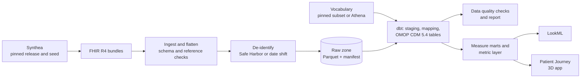

# Design: clinical-data-lakehouse

**Status:** draft, Nov 10, 2026

## Problem

Most observational health research runs on the OMOP Common Data Model: a study written
once runs at any site whose data is in OMOP. Getting there is the hard part. EHR data
increasingly leaves hospitals as FHIR R4, and turning FHIR into OMOP means flattening
nested resources, mapping source codes to standard concepts, building observation
periods and visits that OMOP's rules accept, and proving the result is complete. Teams
usually write this ETL once, by hand, for one site, with no tests and no way to rerun it
when the source changes.

## Goals

- One command takes FHIR R4 bundles to a populated, tested OMOP CDM 5.4 warehouse.
- The same dbt models run on DuckDB (laptop and CI) and BigQuery (scale).
- Every load is idempotent and incremental: new or changed bundles are reprocessed,
  nothing else.
- De-identification runs before anything is modelled, and can be switched to Safe
  Harbor output or to per-patient date shifting for research that needs intervals.
- Quality is measured, not assumed: a data quality report on every build, and row and
  concept coverage compared with an independent reference conversion.
- Analysts get usable marts on top: care gaps and quality measures through one metric
  layer.

## Non-goals

- Real patient data. Development, tests and every published number use Synthea.
- Replacing the OHDSI tools. The output is a standard CDM, so ATLAS, the Data Quality
  Dashboard and HADES packages work on it unchanged.
- Full coverage of every FHIR resource in the first release. The resources Synthea
  emits are covered; others are reported as unmapped instead of dropped silently.

## Data

Synthea (Apache 2.0) generates realistic but fictional patients as FHIR R4 bundles.
The release, seed, population size and module configuration are pinned, so every
number in this repository can be reproduced exactly.

Standard concepts come from the OHDSI vocabularies, which are distributed through
Athena under their own terms, and some source vocabularies carry their own licences.
This repository does not ship vocabulary files. By default the pipeline fetches the
concept subset published in the OHDSI EunomiaDatasets repository (Apache 2.0) at a
pinned commit, which covers the codes Synthea uses; a user with an Athena download can
point the pipeline at it instead. The README states exactly which domains are mapped
and what share of source codes found a standard concept.

## Architecture

## Key decisions (to be recorded as ADRs as they are made)

- Flatten FHIR in Python, model OMOP in dbt. FHIR's nesting is awkward in SQL and
  changes rarely; the OMOP rules (visits, observation periods, concept mapping) are
  where reviewers need to read and test logic, so they live in SQL with tests.
- Source codes are kept next to the mapped concept in every clinical table
  (`*_source_value`, `*_source_concept_id`), so an unmapped code is visible and countable.
- Observation periods are derived from all clinical events per person, not from
  enrollment, because Synthea has no payer enrollment gaps worth trusting.
- Date shifting uses one random offset per person, so intervals inside a patient's
  record are preserved exactly.

## Testing

- Unit tests for flattening and for each de-identification rule, on small handwritten
  bundles.
- dbt contracts and tests on every OMOP table: keys, required fields, concept domains,
  dates within observation periods.
- An end to end test in CI on a small seeded population.
- Comparison with the Eunomia Synthea reference conversion: row counts per table and
  concept coverage per domain within stated tolerances.

## Open questions

- How close a reference comparison can be when the Eunomia data came from a different
  Synthea version; the comparison may have to be on shares rather than counts.
- Whether visits should follow the OHDSI ETL-Synthea rules for collapsing encounters
  into inpatient stays, or a simpler rule that is easier to explain.
